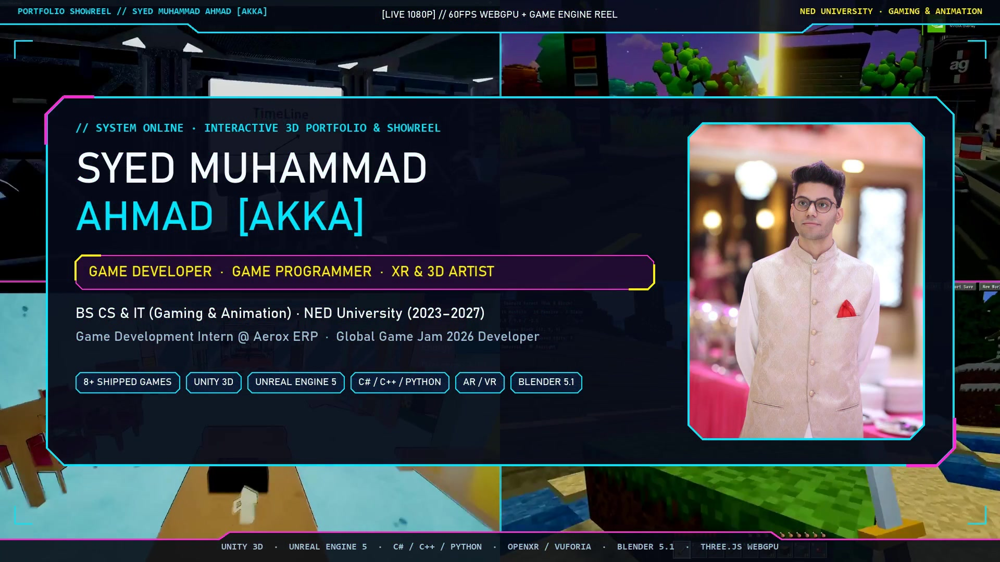

# Syed Muhammad Ahmad (AKKA) — Interactive 3D WebGPU Portfolio



A full-stack interactive 3D web portfolio showcasing the personal profile, technical skills, academic game projects, and professional achievements of **Syed Muhammad Ahmad (AKKA)** — Game Developer, Game Programmer, and Graphic Designer (BS CS & IT — Gaming & Animation at **NED University of Engineering & Technology**).

---

## Project Modules & Architecture

| Module | Implementation & Deliverables | Key Paths |
|--------|-------------------------------|-----------|
| **Module 1: 3D Web-Based Portfolio** | Rainy cyberpunk alley rendered in real time with **Three.js WebGPU** & **Three Shading Language (TSL)** (GPU height-map rain collision, wet-ground planar reflection, BVH first-person walk & orbit controls, cyberpunk post-processing) + responsive glassmorphic dock & slide-over sections (**Home**, **About**, **Skills**, **Projects**, **Journey**, **Contact**). | [`src/main.js`](src/main.js), [`src/portfolio/createPortfolioUI.js`](src/portfolio/createPortfolioUI.js), [`src/portfolio/portfolio.css`](src/portfolio/portfolio.css), [`content/profile.json`](content/profile.json) |
| **Module 2: Custom 3D Avatar (Blender 5.1)** | Original stylized 3D character of Syed Muhammad Ahmad modelled, shaded with Principled BSDF PBR materials, rigged with an 18-bone armature (`AvatarRig`), facial morph targets (`Blink`, `Smile`, `MouthOpen`), and 5 animation clips (`Idle`, `Wave`, `Talk`, `Point`, `Victory`). Integrated into the 3D alley with cursor head-tracking, proximity auto-wave, and voice lip-sync. | [`blender/build_avatar.py`](blender/build_avatar.py), [`blender/avatar.blend`](blender/avatar.blend), [`public/models/avatar.glb`](public/models/avatar.glb), [`blender/avatar_preview.png`](blender/avatar_preview.png), [`src/world/avatar/loadAvatar.js`](src/world/avatar/loadAvatar.js) |
| **Module 3: Animated Promotional Video (After Effects)** | 46-second 1080p@30fps promotional video introducing Syed Muhammad Ahmad, his technical arsenal, gameplay footage from his Unity & Unreal Engine 5 games, **FilmBro VFX Assets Pack** overlays (Cyberpunk Glitch, Hollywood HUD frames, Real Particles, Sparks), and an original 100 BPM dark-synthwave soundtrack synthesized in Python (CC0). | [`video/build_promo.jsx`](video/build_promo.jsx), [`video/promo.aep`](video/promo.aep), [`video/music/make_music.py`](video/music/make_music.py), [`public/video/promo.mp4`](public/video/promo.mp4), [`public/video/promo-poster.jpg`](public/video/promo-poster.jpg) |
| **Module 4: RAG-Based AI Chatbot (`AHMAD.AI`)** | Grounded Retrieval-Augmented Generation pipeline over `content/profile.json`, `knowledge/SyedMuhammadAhmad_CV.pdf`, and `knowledge/portfolio-details.md`. Uses sentence-boundary chunking, 768-dim **Google Gemini** (`gemini-embedding-001`) embeddings + BM25 hybrid retrieval (`data/vector-index.json`), and **Gemini Flash** generation with strict anti-hallucination rules and clickable citations (`[1]`, `[2]`). | [`scripts/ingest.mjs`](scripts/ingest.mjs), [`data/vector-index.json`](data/vector-index.json), [`api/chat.js`](api/chat.js), [`api/_lib/retriever.js`](api/_lib/retriever.js), [`api/_lib/gemini.js`](api/_lib/gemini.js) |
| **Module 5: Email & Contact System** | Shared frontend + backend validation (`name`, `email`, `subject`, `message`), HTML sanitization, honeypot field (`website`), minimum fill-time bot check (`3000 ms`), sliding-window IP rate limiter, and transactional email delivery via **Resend API** (`POST /api/contact`). | [`shared/validation.js`](shared/validation.js), [`api/contact.js`](api/contact.js), [`api/_lib/http.js`](api/_lib/http.js) |
| **Module 6: Deployment & Documentation** | Configured for one-command deployment to **Vercel** (`vercel.json`) with serverless `/api/chat` and `/api/contact` functions, security headers, and comprehensive PDF project report (`docs/Project_Report.pdf`). | [`vercel.json`](vercel.json), [`.env.example`](.env.example), [`docs/Project_Report.pdf`](docs/Project_Report.pdf) |

---

## Extra-Credit Features Implemented
1. **Interactive 3D Objects Responding to Mouse Movement**: The 3D avatar's `Head` bone smoothly tracks the visitor's cursor in real time, and click-to-focus Depth of Field (DoF) shifts camera focus to any 3D object.
2. **Dark & Light Themes**: Instant toggle in the bottom navigation dock (`Dark` / `Light` mode) persisted in `localStorage`.
3. **Voice Interaction with the Chatbot**: Web Speech API microphone input (`SpeechRecognition`) and spoken voice responses (`speechSynthesis`) that drive the 3D avatar's `MouthOpen` lip-sync morph target and `Talk` animation.
4. **Multilingual Chatbot Support**: Language selector (`Auto`, `English`, `Urdu`, `Arabic`, `Chinese`, `Spanish`, `French`) translating grounded portfolio answers automatically.
5. **Animated 3D Avatar Expressions & Gestures**: Live buttons to trigger `Wave`, `Talk`, `Point`, `Victory`, `Idle`, turntable rotation, periodic `Blink` morphs, and `Smile` expressions.
6. **Project Filtering & Search**: Instant category tabs (`All`, `Game`, `XR`, `Web`) and live keyword search across all 9 projects.
7. **Chatbot Source Citations Linking to Portfolio Content**: Clicking any `[1]`, `[2]` citation chip in the chat opens the corresponding portfolio section and scrolls directly to the cited project card.
8. **Website Analytics & Accessibility**: Integrated `@vercel/analytics`, ARIA labels/live regions, semantic roles, and keyboard navigation.

---

## Setup & Installation Instructions

### 1. Prerequisites
- **Node.js** `>= 20` and `npm`
- A modern browser with **WebGPU** support (Chrome, Edge, or Firefox Nightly / Safari TP)
- *(Optional, for rebuilding 3D/video assets from scratch)*: **Blender 5.1**, **Python 3.10+**, **Adobe After Effects**

### 2. Install Dependencies
```bash
npm install
```

### 3. Configure Environment Variables
Copy `.env.example` to `.env` and fill in your keys:
```bash
cp .env.example .env
```
- `GEMINI_API_KEY`: Your Google AI Studio API key (for RAG embeddings & chat generation).
- `RESEND_API_KEY`: Your Resend API key (`re_...`) for contact form email delivery.
- `CONTACT_TO_EMAIL`: Recipient inbox (`ahmedakka765@gmail.com`).
- `CONTACT_FROM_EMAIL`: Verified sender (`Portfolio Contact <onboarding@resend.dev>`).

### 4. Build the RAG Vector Index
Whenever you edit `content/profile.json` or drop new `.md`/`.pdf` files into `knowledge/`:
```bash
npm run ingest
```
This chunks all documents, generates 768-dimensional Gemini embeddings, and writes `data/vector-index.json`.

### 5. Run Locally (HTTPS Dev Server + Local `/api/*` Endpoints)
```bash
npm run dev
```
Vite starts an HTTPS server (required for WebGPU) and mounts both `/api/chat` and `/api/contact` locally.

### 6. Production Build & Verification
```bash
npm run build
npm run test:api
```

### 7. Deploy to Vercel
```bash
npx vercel --prod
```
Ensure `GEMINI_API_KEY`, `RESEND_API_KEY`, `CONTACT_TO_EMAIL`, and `CONTACT_FROM_EMAIL` are added in **Vercel Project Settings → Environment Variables**.

---

## Credits
- **Portfolio Owner & Game Developer**: Syed Muhammad Ahmad (AKKA)
- **3D Alley Base Technique**: Inspired by *Threejs-Punk* (Anderson Mancini & Sunag, TSL Workshop 2026)
